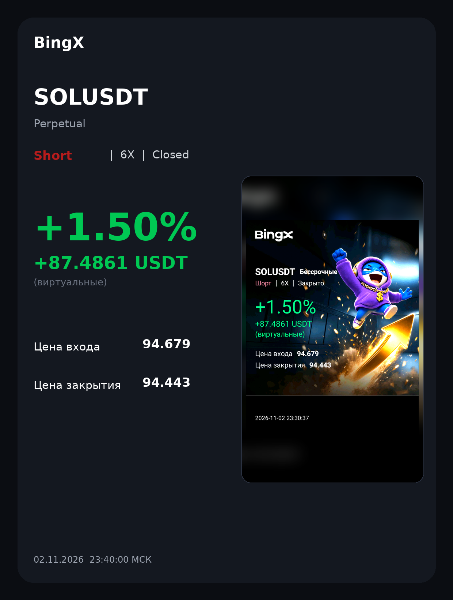
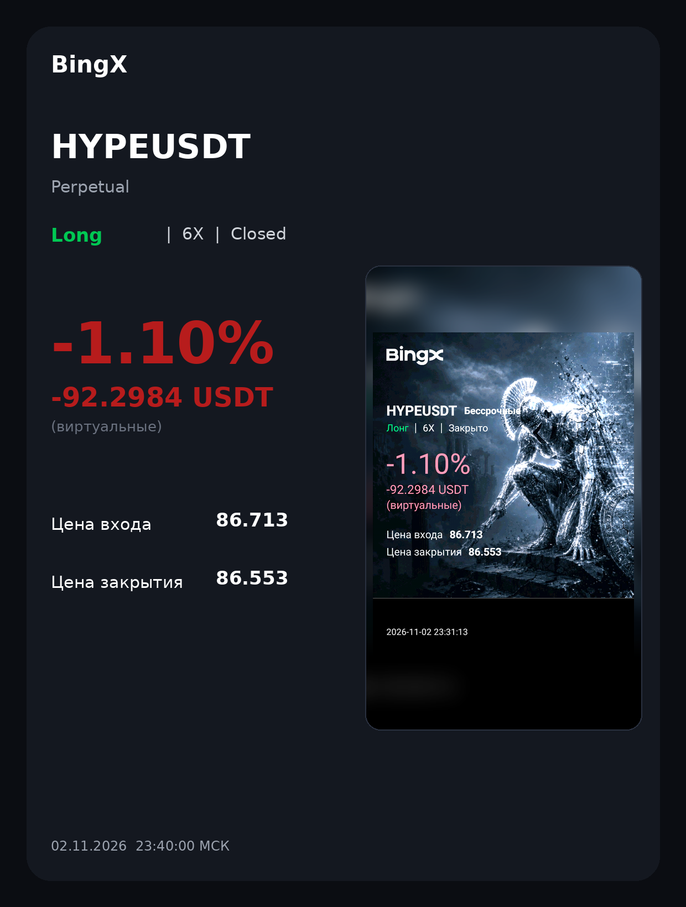
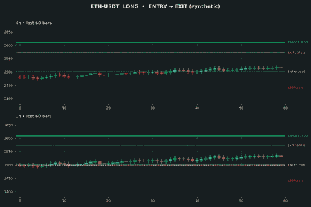

# ASTRA BOT — BingX USDT-M / Zeus

**ASTRA BOT by Gamadril — исследовательская система Zeus для BingX USDT-M.** Проект разделяет бумажный симулятор, демо-торговлю VST и отдельный закрытый контур реального счёта. GitHub Actions исполняет короткие задачи и сохраняет состояние в репозитории; VPS для текущих циклов не требуется.

Путь проекта: от paper-проверки правил — к live VST-циклу, затем к наблюдательным слоям (объёмные зоны и профили сессий), визуальной отчётности и защищённому архиву данных. **COPY_ZEUS сейчас только собирает и хранит данные read-only: сделки между счетами ещё не копируются.**

Числовые параметры и их источники — в **[SETTINGS.md](SETTINGS.md)**. Это канон; изменения риска, плеча, рабочих контуров и разрешений выполняются только по прямому слову владельца.

## Контуры

| Контур | Что делает | Текущий режим |
|---|---|---|
| **Paper** | Симулятор: проверяет стратегии и сопровождение на бумажных позициях. | Отдельный `zeus-paper-clock`; не отправляет реальные ордера. |
| **Live VST / демо** | Исполняет live-loop на демо-счёте BingX, сопровождает демо-позиции и собирает телеметрию. | Тик примерно раз в **5 минут** через внешний cron-job.org, который вызывает `workflow_dispatch`. GitHub `on.schedule` снят; в YAML оставлен ручной вход. |
| **Real / реальный счёт** | Контур реального счёта. | **ЗАМОК.** Включение и любой переход к реальным операциям — только отдельным прямым словом владельца. Наличие read-only архива не означает разрешения торговать. |

`ZEUS_LIVE` — защитный флаг live-workflow: при значении, отличном от `1`, live-адаптер не запускается. Флаги `ZEUS_VST` / `ZEUS_MAINNET`, API-секреты и `ZEUS_ARM` передаются через Actions secrets; секреты не хранятся в исходниках и не должны выводиться в логи.

Paper, VST и real — разные контуры. Демо не является реальным исполнением, а архив реального счёта не является копитрейдингом.

## Стратегия и защита

Основной Zeus-подход объединяет **channel + wedge**: работу от канала и клина с ретестом. Дополнительная ветка ищет пробой двойных и тройных вершин (**multi-top breakdown**) на старших и младших данных **4h + 1h**. Для ложного пробоя используются подтверждение `div_zeus`, HTF-направление и проверка касаний структуры; наблюдательные фильтры не должны подменять канонические настройки.

### Риск-лестница и стоп-краны

| Правило | Значение из кода / SETTINGS |
|---|---:|
| Confidence risk ladder | confidence ≥ 0.88 → **3%**; ≥ 0.80 → **2%**; ≥ 0.70 → **1.5%** |
| MAX_OPEN | **5** позиций |
| SAME_SIDE_SOFT_CAP | **3** позиции в одну сторону |
| Cooldown входа | **20 минут** на strategy / symbol / side |
| VOL_EXPANSION cooldown | **30 минут** |
| FRESH_MAX_SEC | **45 минут** |
| FORCE_LEVERAGE в live workflow | **6×** |
| MAX_LEVERAGE | **10×** |
| Take RR clamp | **[2.0; 2.3]** |
| Части TP | **30% / 70%** |
| Дневной / недельный лимит потерь | **4% / 6%** от реального equity |

Kill-switch по PF срабатывает при **n ≥ 5** и **PF < 1**. Окно PF задаётся `ZEUS_KILL_PF_WINDOW=20`. Дневной и недельный ограничители учитывают реальные значения equity, а не размер бумажного баланса. Эти пороги нельзя менять без владельца.

### Exit-engine

Переключатель `ZEUS_LIVE_EXIT_ENGINE` поддерживает `shadow`, `on` и `off`; значение по умолчанию в коде — `shadow`. В текущем `zeus-live-clock.yml` явно передаётся `on` вместе с `ZEUS_LIVE_TRAIL_POLICY=atr`, поэтому workflow-настройка отличается от значения по умолчанию. Политика `atr` использует **2×ATR14**, основной таймфрейм 4h с fallback на 1h. Переключение режимов — только по слову владельца.

## Volume-zone shadow — наблюдения у зон объёма

На каждом live-скане отдельный наблюдательный модуль пересчитывает профиль объёма и выделяет горизонтальные зоны, где торговалось особенно много. Текущий алгоритм использует **24 бина**, сглаживание по **3 бинам** и сохраняет до **6** сильных зон в радиусе **±10%** от текущей цены.

В журнал попадает событие `zone_shadow`: цена, ближайшие зоны, расстояние до них и признак нахождения внутри зоны. Файл `models/zone_shadow_approach.json` хранит минимальное расстояние цены до каждой зоны в пределах текущей закрытой 4h-свечи; при смене свечи пишется сводка предыдущего периода.

Это **не сигнал на вход** и не меняет риск. Простыми словами: бот отмечает, где находится крупный объём и насколько близко к нему подходила цена. Позже эти наблюдения можно использовать для обучения и проверки поведения бота около объёмных уровней.

## Профили сессий (МСК)

При `ZEUS_SESSION_PROFILE=1` профиль выбирается по часу MSK отдельно для будней и выходных. `off` запрещает новые входы, но открытые позиции продолжают сопровождаться.

**Будни**

| Профиль | Часы МСК | Новые входы | BE trigger | TP1 RR |
|---|---|---:|---:|---:|
| fat | 10–12, 16–20 | да | 0.50R | 0.70 |
| normal | 03–06, 13–15, 21–22 | да | 0.40R | 0.55 |
| thin | 00–02, 23 | да | 0.30R | 0.45 |
| off | 07–09 | нет | 0.30R | 0.45 |

**Выходные**

| Профиль | Часы МСК | Новые входы | BE trigger | TP1 RR |
|---|---|---:|---:|---:|
| normal | 16–19 | да | 0.40R | 0.55 |
| thin | 10–12, 15, 20–21 | да | 0.30R | 0.45 |
| off | остальные часы | нет | 0.30R | 0.45 |

Профиль — это способ учитывать разную ликвидность в течение суток: в активные часы дать сделке больше пространства, в тонкие часы фиксировать результат раньше, а в мёртвые окна не открывать новые позиции.

## Карточки сделок

EXIT-карточка занимает весь холст **1240×1640**. Фон берётся из арта владельца по знаку реализованного PnL: плюс — тёплый золотой талисман со стрелой, минус — воин на коленях. Цифры и подписи размещаются поверх затемняющего градиента, чтобы их было видно на иллюстрации.

&nbsp;&nbsp;

## Графики сделок ENTRY / EXIT

При входе и подтверждённом закрытии сделка может сопровождаться графиком из двух панелей: **4h + 1h**, последние примерно **60 свечей** на каждом таймфрейме. На графике отмечены ENTRY, STOP и TARGET; для закрытия дополнительно показывается EXIT. Визуализация информационная и не принимает торговых решений.

*Пример построен на синтетических свечах, это не реальная сделка и не биржевые котировки.*

## COPY_ZEUS — копитрейдинг, этап 1

Сейчас COPY_ZEUS — это **read-only архив реального счёта**, а не копирование ордеров. Внешний cron-job.org вызывает `copy-zeus-archive.yml` раз в **30 минут**, на минутах **07 и 37**. Сам workflow имеет только `workflow_dispatch`: GitHub schedule не используется.

Архиватор читает только три разрешённых GET-направления BingX: `positions`, `allOrders` и `income`. Для income ведётся проход в пределах последних **24 часов**: страницы читаются назад до пересечения с уже известными событиями или до лимита страниц. Данные дедуплицируются по ключу события; позиции записываются как наблюдения. Клиент не предоставляет методов создания, изменения или закрытия ордеров.

Архив упаковывается и шифруется **AES-256-SIV**. Ключ длиной 64 байта выводится через SHA-512 из доменного разделителя и существующего `BINGX_API_SECRET`; новый API-ключ для архива не заводится. Месячные JSONL-ротации ограничены **10 MiB** каждая, итоговый зашифрованный комплект — **64 MiB**; в Actions artifact сохраняются зашифрованный файл и манифест.

Для retryable-ответа **100410** (и временных сетевых ошибок / HTTP 429) клиент делает до **4 попыток всего** с паузами **5 / 30 / 60 секунд** между ними. Это четыре запроса, а не четыре паузы. Этот режим проверяется отдельным тестом.

**Копирование сделок между счетами не включено.** Никаких автоматических входов, выходов или зеркалирования позиций COPY_ZEUS не выполняет.

## Workflows GitHub Actions

Все рабочие контуры вызываются через `workflow_dispatch`, если не указано иное. Удалённый `on.schedule` не следует путать с внешним cron-job.org: внешний сервис только отправляет dispatch-событие.

| Workflow | Триггер по YAML | Назначение |
|---|---|---|
| `bot.yml` | workflow_dispatch | Paper/TG-бот: короткая сессия, команды Telegram и сохранение состояния; внешний cron может вызывать dispatch. |
| `zeus-paper-clock.yml` | workflow_dispatch | Однократный multi-symbol paper-тик Zeus и публикация paper-статуса. |
| `zeus-live-clock.yml` | workflow_dispatch | Live VST clock, Telegram-команды, защита и сохранение live-state; внешний cron-job.org вызывает примерно раз в 5 минут. |
| `copy-zeus-archive.yml` | workflow_dispatch | Read-only архив реального счёта; внешний cron-job.org — минуты 07/37. |
| `copy-zeus-probe.yml` | workflow_dispatch | Ручной read-only probe с выбором `vst` / `real` и безопасным отчётом-артефактом. |
| `quality-gates.yml` | pull_request и push в master | Полные PR-ворота: pytest, Ruff изменённых Python-файлов, import smoke, state-size, Gitleaks. |
| `market-aware-smoke.yml` | push в master и workflow_dispatch | Компиляция и smoke-import market-aware модулей. |
| `morning-report.yml` | workflow_dispatch | Отправка утреннего отчёта в Telegram по запросу. |
| `full-research-audit.yml` | workflow_dispatch | Большой исторический аудит рынка и портфеля; выгружает отчёты как artifacts. |
| `strategy-lab.yml` | workflow_dispatch | Историческое исследование стратегий, walk-forward и Monte Carlo; только исследование. |
| `track-c-deep.yml` | workflow_dispatch | Глубокий исторический Zeus Track C по BTC / ETH / SOL; исследовательский контур. |

В `quality-gates.yml` нет автоматического разрешения на мерж: красная проверка блокирует его. Каждый PR проходит тесты, Ruff, import smoke, проверку размера `models/` и Gitleaks.

## Роли и права управления

| Роль | Ответственность |
|---|---|
| **Исполнитель (Грок)** | Изучает задачу, выполняет согласованные изменения в отдельной ветке, готовит минимальный diff, тесты и PR; сообщает файлы, SHA и результаты gates. |
| **ИИ-аналитик (ChatGPT)** | Анализ архитектуры и журналов, аудит, документация и PR по поручению владельца; не runtime-бот, ключами/риском/ON/REAL не управляет, merge не решает. |
| **Арена** | Независимо проверяет технический diff, API-поведение, тесты и соответствие заданным границам; даёт вердикт по готовности. |
| **Внешняя автоматика (cron-job.org)** | Вызывает `zeus-live-clock.yml` примерно раз в 5 минут и `copy-zeus-archive.yml` каждые 30 минут на минутах 07/37. Это внешний dispatch-планировщик; GitHub schedule у этих workflow отсутствует. |
| **Владелец** | Единолично разрешает merge, ON/ENV-переключения, изменения риска, управление cron-job.org и любые действия с реальным счётом; хранит Actions Secrets. |

## Документация

- **[SETTINGS.md](SETTINGS.md)** — канон чисел Zeus: риск-лестница, RR, выходы и фактические live env.
- **[docs/CONFIGURATION_MAP.md](docs/CONFIGURATION_MAP.md)** — где живут общие настройки, paper Zeus, live overrides и Actions Secrets.
- **[docs/PR_HISTORY.md](docs/PR_HISTORY.md)** — хроника всех PR репозитория.
- **[docs/INDEX.md](docs/INDEX.md)** — карта технической документации.
- [ARCHITECTURE.md](docs/ARCHITECTURE.md) · [DECISION_PIPELINE.md](docs/DECISION_PIPELINE.md) · [GITHUB_ACTIONS.md](docs/GITHUB_ACTIONS.md) · [REAL_READINESS.md](docs/REAL_READINESS.md).

## Права

Код публичен для прозрачности и аудита. Использование, копирование, модификация и форки — только с письменного разрешения автора (см. [LICENSE](LICENSE)).

## Дисклеймер

Учебно-исследовательский проект. Торговля фьючерсами с плечом может привести к полной потере средств. Бумага и демо; реал отключён. Автор не несёт ответственности за использование.
